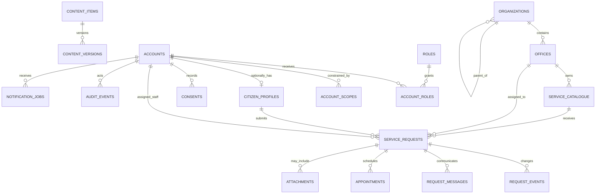

# 2. Database Architecture and ERD

**Version:** 0.1 · PostgreSQL logical design · Subject to data-owner approval

## 2.1 Design principles

- Separate citizen identity/service data from restricted staff administration.
- Use purpose-specific schemas and least-privilege database roles.
- Use opaque UUIDs for public-facing identifiers; never expose sequential
  primary keys as request references.
- Keep personal identifiers out of logs, analytics, URLs and object names.
- Encrypt sensitive columns with managed keys where justified; store key
  material outside the database.
- Classify every field, name a controller/owner, specify legal purpose,
  retention, correction path and deletion behavior before collection.
- Keep uploaded binary files in private object storage; database stores
  metadata and integrity digest only.
- Record sensitive reads and all writes in append-only audit storage.
- Do not create tables for surveillance, political affiliation, biometrics,
  citizen risk scores, continuous locations or automated enforcement.
- Police-internal personnel/case/evidence modules are future, separately
  authorized domains. They are not joined to citizen accounts.

## 2.2 Logical schemas

| Schema | Responsibility |
|---|---|
| `iam` | Accounts, OIDC subject mapping, roles, scopes, MFA and sessions |
| `org` | Departments/offices, public service directory and review ownership |
| `citizen` | Minimal citizen profile, consent and notification preferences |
| `service` | Service catalogue, requests, status history and appointments |
| `content` | Reviewed announcements, FAQ and public document metadata |
| `files` | Quarantined/private attachment metadata and access grants |
| `notify` | Notification templates, delivery jobs and outcomes |
| `audit` | Access/action audit events, export approvals and retention events |
| `governance` | Data categories, retention schedules, legal holds and review records |
| `reporting` | Approved, minimized aggregates; no unrestricted person-level analytics |

Use schema-scoped database roles: migration owner, application runtime,
read-only reporting, audit writer, and backup operator. Runtime users do not
own tables or alter audit history.

## 2.3 Core entities

### Identity and organization

- `iam.accounts`: `id UUID PK`, `oidc_issuer`, `oidc_subject`, `account_type`,
  `status`, `created_at`, `disabled_at`. Unique `(oidc_issuer, oidc_subject)`.
  No password field when an external OIDC provider is used.
- `iam.roles`: stable `code`, display name, description, privileged flag.
- `iam.permissions`: resource/action pair and sensitivity tier.
- `iam.account_roles`: account, role, grantor, valid-from/to, reason.
- `iam.account_scopes`: account, scope type (`GLOBAL`, `REGION`, `DISTRICT`,
  `OFFICE`), scope ID, validity and grantor.
- `iam.sessions`: provider session reference hash, created/expiry/revocation.
- `org.organizations`: parent organization, type, status and owner.
- `org.offices`: organization, parent office, public name, jurisdiction label,
  published contact/address/hours, language, review date and status.
- `org.office_contacts`: office, channel type, value, public flag, verified-at,
  expires-at and verified-by.

### Citizen and service

- `citizen.profiles`: account FK, optional display name, preferred locale,
  verified contact references and timestamps. Do not require date of birth or
  address for generic account creation.
- `citizen.consents`: account, purpose code, notice version, choice, timestamp,
  channel and withdrawal timestamp. Consent is not a substitute for legal
  authority.
- `service.catalogue`: service code, localized title/description, owning
  office, required fields/document policy, publication state and review dates.
- `service.requests`: opaque reference UUID, service FK, optional citizen FK,
  private contact snapshot only when needed, category, description,
  incident-date/location only when relevant and explicitly submitted,
  visibility mode, status, assigned office/account, purpose, created/updated
  and retention class.
- `service.request_events`: request FK, actor, previous/new state, event type,
  citizen-visible flag, reason code, timestamp and correlation ID.
- `service.request_messages`: request FK, sender class, body, visibility,
  created-at; redact/expire according to approved policy.
- `service.appointments`: request/citizen, office/service, start/end,
  status, cancellation reason, created-at. No unnecessary visit tracking.
- `service.reference_tokens`: request FK, keyed token digest, expiry,
  throttling counters and last-used time. Do not store plaintext lookup tokens.

### Content, files, notifications and governance

- `content.items`: type, owner, state, current version, scheduled window,
  reviewer/approver IDs and timestamps.
- `content.versions`: item FK, locale, title/body, source references,
  author, checksum and created-at.
- `files.attachments`: owner type/ID, opaque object key, original filename
  encrypted or minimized, claimed/detected MIME, size, SHA-256, scan state,
  classification, retention class, upload account and created-at.
- `files.access_events`: attachment, actor, purpose, action, result and time.
- `notify.jobs`: recipient account/contact token, template/version, channel,
  delivery status, retry count, next attempt and provider message ID.
- `audit.events`: immutable event ID, actor, action, resource type/opaque ID,
  purpose, scope, timestamp, request ID, result, source and integrity-chain
  reference. Exclude secrets, full complaint text and unnecessary PII.
- `governance.data_catalogue`: field/category, purpose, owner, lawful basis
  decision reference, sensitivity, retention class and approved location.
- `governance.retention_rules`: data class, active period, archive period,
  deletion method, legal-hold handling, approver and effective version.
- `governance.export_approvals`: requester, purpose, dataset, scope,
  approvers, expiry, completion hash and audit link.

## 2.4 ERD

In the physical database, `service.requests` references citizen profiles
through an optional account ID; the citizen read API additionally checks
session ownership. The diagram does not imply access across domains.

## 2.5 Data classification and constraints

| Class | Example | Default handling |
|---|---|---|
| Public | Approved office address, public notice | Publish only after review |
| Internal | Staff schedule, draft content | Authenticated role/scope |
| Confidential | Citizen contact, request narrative | Purpose-limited, masked, audited |
| Restricted | Sensitive attachment, child-related report | Need-to-know, separate grant, step-up auth |

- Enforce foreign keys, `CHECK` constraints for enums/valid time windows, and
  optimistic concurrency (`version` integer) for stateful records.
- Never use free-text location or phone values in analytics dimensions.
- Store timestamps in UTC; render using configured Myanmar locale/time zone.
- Add indexes on opaque reference digest, owner+created time, status+assigned
  office, and notification scheduling; avoid broad indexes over PII.
- Use partitioning/archiving only after volume and restore testing.
- Do not use database row-level security as the only authorization control;
  API authorization and tested query scoping are mandatory.

## 2.6 Retention and deletion

Retention durations are intentionally **TBD by the lawful data owner and
qualified local counsel**. The design supports:

1. Request-specific retention class at creation.
2. Expiry queue and deletion certificate.
3. Legal hold with authority, scope, approver, review date and removal audit.
4. Attachment/object deletion and backup-expiry tracking.
5. Pseudonymization for approved aggregate reporting.
6. Correction workflow without rewriting immutable historical audit events.

## 2.7 Future restricted records

If personnel, formal case or evidence data is later authorized, design a
separate restricted schema/service, separate keys and storage, strict
case/assignment scope, dual approval for export, and independently reviewed
retention/custody rules. Do not expose these records through citizen APIs or
join them to citizen analytics.
