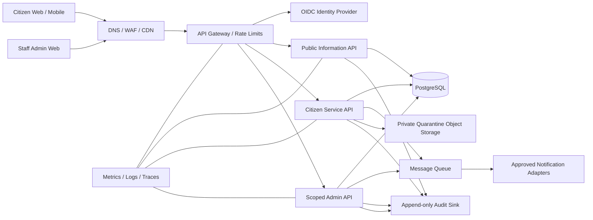

# 8. Deployment and Infrastructure Architecture

**Status:** Proposed target architecture; hosting location and agency network
requirements remain decisions for discovery.

## 8.1 Logical architecture

Citizen, public and internal APIs have distinct authorization policies. The
diagram is conceptual and does not authorize connections to police, court,
identity, payment or emergency systems.

## 8.2 Technology proposal

- Web: Next.js + TypeScript.
- Mobile: React Native or Flutter, selected after offline/accessibility
  prototype.
- Backend: FastAPI modular monolith, versioned OpenAPI.
- Data: PostgreSQL; Redis only for cache/queue/session support where justified.
- Identity: managed OIDC provider (e.g. Keycloak or approved alternative),
  configured with MFA.
- Files: S3-compatible private object storage with quarantine and malware scan.
- Async: managed queue/worker; delivery adapters isolated from request API.
- Edge: Nginx/API gateway plus WAF, TLS termination and DDoS controls.
- Observability: Prometheus/Grafana-compatible metrics and centralized
  redacted logs; error monitoring must not capture request bodies.
- Packaging: Docker, infrastructure-as-code, protected CI/CD and signed images.

Final choices require security review, data residency confirmation, support
capability and procurement approval.

## 8.3 Environments and network

- **Development:** synthetic data; local/private access; no production secrets.
- **Test/staging:** isolated identity and storage, masked/synthetic fixtures,
  security testing with explicit authorization.
- **Production:** private database/object store, managed secrets/KMS, private
  admin access path, WAF/API gateway, segmented worker subnets and restricted
  egress.
- Separate security account/project for backup and audit where feasible.
- Egress allowlist for identity, approved message provider and security
  updates; no arbitrary outbound calls from citizen-facing services.

## 8.4 Availability, backup and recovery

Initial pilot targets (to be validated and funded):

- 99.5% monthly availability for public information/service intake.
- PostgreSQL point-in-time recovery; encrypted daily full backup plus tested
  continuous/WAL or equivalent recovery.
- Initial RPO 24 hours, RTO 8 hours; target stricter recovery only after
  multi-zone design, cost and drills are approved.
- Encrypted object versioning and lifecycle rules matching retention.
- Quarterly restore test, annual disaster-recovery exercise, documented
  alternate public information channel.
- Fail safely: if dispatch or notification integration is unavailable, state
  is visible to users and alternative contact instructions are shown; never
  silently report success.

## 8.5 Delivery pipeline

1. Pull request with mandatory review and linked requirement/test IDs.
2. Formatting, lint, type-check, unit tests, secret scan, SAST, dependency and
   container scan.
3. Build immutable image; generate SBOM; sign artifact.
4. Deploy to isolated staging; migration dry-run and integration/access tests.
5. Approval from product owner and security/release approver.
6. Canary/blue-green deployment, health checks and rollback threshold.
7. Production smoke test with synthetic account; no real citizen submission.
8. Record release version, migration, approvers and rollback outcome.

Database migrations are backward-compatible where possible; backup and
restore readiness is checked before destructive schema changes. Production
data is never copied to test.

## 8.6 Monitoring and operations

- Availability, latency, error rate, queue lag, storage, backup age and
  delivery-provider health.
- Security alerts for auth anomalies, scoped-access denials, export and
  audit-pipeline interruption.
- Redact PII at source; access to observability is itself audited.
- Runbooks for degraded service, provider outage, compromised account,
  suspected data exposure, backup restore and content withdrawal.
- Named owners and on-call escalation are procurement prerequisites.

## 8.7 Sizing and cost dependencies

Capacity and cloud cost require pilot geography, peak concurrency, upload
volume, retention, residency, availability and DR decisions. Use load tests
against synthetic data and scale on aggregate workload, not individual
profiling. Cloud/vendor recurring fees are excluded from the ROM estimate.
